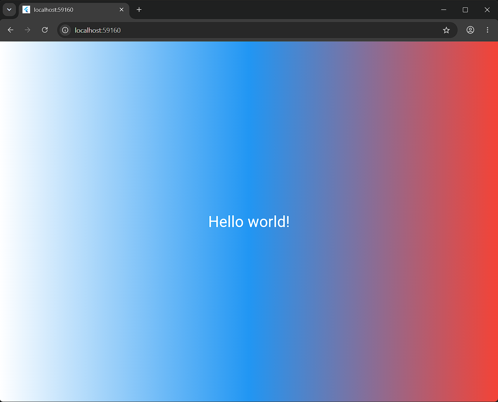

# Flutter Lab 3

Мой первый проект на Flutter, созданный в рамках лабораторной работы №3. Приложение выводит приветствие на градиентном фоне.

## Информация об авторе

Студент: Колесников Владислав Александрович
Группа: ИСП-241

## Стек и версии

- Flutter 3.x.x
- Dart 3.x.x
- Платформа: Web (Chrome)
- IDE: VS Code

## Скриншот приложения

## Как запустить

1. Клонировать репозиторий: `git clone <https://github.com/Demor865/first_flutter_app.git>`
2. Перейти в папку проекта: `cd first_flutter_app`
3. Выполнить `flutter pub get`
4. Запустить командой `flutter run -d chrome`

## Что изучили

1. Структуру Flutter-проекта и основные команды (`flutter create`, `flutter run`).
2. Понятие виджета и дерева виджетов (Widget Tree).
3. Базовые виджеты: `MaterialApp`, `Scaffold`, `Container`, `Center`, `Text`.
4. Работу с Hot Reload (r) и Hot Restart (R).
5. Оформление фона через `BoxDecoration` и `LinearGradient`, а также стилизацию текста через `TextStyle`.
